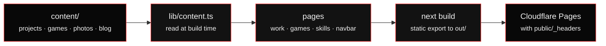

<div align="center">


<br/>


<br/><br/>

<b>The portfolio of a game and VR developer and 3D artist who trained as a Geomatics Engineer: games, Blender props, virtual tours and LiDAR, on one static site.</b>

<br/><br/>

<a href="https://www.prabhatbhusal.com.np"></a>
<a href="https://sketchfab.com/bhusalprabhat"></a>
<a href="https://www.artstation.com/prabhatbhusal"></a>

<br/><br/>

<a href="#overview"><code>[ overview ]</code></a> ·
<a href="#whats-inside"><code>[ inside ]</code></a> ·
<a href="#how-content-flows"><code>[ flow ]</code></a> ·
<a href="#repository"><code>[ repo ]</code></a> ·
<a href="#getting-started"><code>[ run it ]</code></a>

</div>


<sub><code>[ player profile ]</code></sub>

## Overview

Games taught me to think in 3D space, a Geomatics degree taught me to measure
it, and the web is how the work gets shipped. At RCAAS Technology I build VR
and the [studio platform](https://github.com/prabhatbhusal/Three-D-GS-platform)
that turns LiDAR-captured places into Gaussian-splat tours people can walk
through. Lately I model my own props in Blender as well.

This repo is the site that shows all of it:

- **Games**: PC builds in Unity and Unreal Engine, each with its own page
- **Work**: VR, 3D and LiDAR projects, with what each one does, the year, my role and the decisions that mattered
- **3D models**: Sketchfab viewers you can spin on the page, also listed under games
- **Skills**: unlocked by shipping, so every tool points at the project that first used it
- **Blog**: notes on LiDAR and real-time 3D
- **Gallery** and **Contact**: scenes from the field, a form, and my local time

> [!NOTE]
> The site is fully static. There is no server, API or database: every page is
> prerendered from the files in [`content/`](content) at build time.


<sub><code>[ inventory ]</code></sub>

## What's inside

Everything is driven by one set of semantic tokens in
[`globals.css`](src/app/globals.css). Dark first, light on request: black and
white with one signal red, kept to highlights. Geist Mono everywhere, the way
a terminal or a game HUD sets type.

| Piece | What it does |
| :--- | :--- |
| **Navbar** | Taken from the 3D-GS platform: a glass pill that folds to its links on the way down and opens on the way up, a scroll-drawn scan line, a viewfinder that glides to the current page, and panels that unroll like a curtain. On phones it grows into one card. |
| **Scroll rail** | The section nav stood on its end down the right edge: a track the scroll fills, a `000%` readout, and the current section's name written up the rail. Any `<section id>` joins it by itself. |
| **3D hero** | A live LiDAR-style point cloud of a valley, built in three.js. Points assemble like a reconstruction resolving and a scan band sweeps through. An SVG mesh stays as the fallback without WebGL. |
| **Inside a build** | The section pins while a procedural three.js gamepad turns and comes apart into shells, circuit board, sticks and buttons. No model files: every part is built in code. |
| **3D model viewer** | Work entries with a Sketchfab `embed` show the model on their page, lazy loaded behind a still. The CSP allows frames from `sketchfab.com` and nothing else. |
| **Boot screen** | Once per visit, a game's "loading world" with a segmented bar and a `000%` counter driven by a CSS custom property, so it runs from first paint with no script. |
| **HUD cursor** | A small 3D crystal on the pointer. Corner brackets lock onto anything clickable, with a live coordinate readout and a ping on every click. |
| **Stacked disciplines** | Cards stack as you scroll beside a turntable (a d20, a code cube, a point-cloud globe) that turns each time a card lands. |
| **Skills** | Derived from what shipped. Anything still being learned shows as locked, on purpose. |


<sub><code>[ pipeline ]</code></sub>

## How content flows



Edit a file in [`content/`](content), commit, and the next deploy picks it up.

- **Posts**: one file per post in [`content/blog/`](content/blog). The format is
  in [`src/lib/blog/format.ts`](src/lib/blog/format.ts), and a bad post fails
  the build instead of reaching the page.
- **Projects, games, photos**: [`projects.json`](content/projects.json),
  [`games.json`](content/games.json), [`photos.json`](content/photos.json).
- **Archiving**: `"archived": true` on a project or post keeps its page at
  the same url (marked noindex) but takes it out of every list, the navbar,
  skills and the sitemap. Archived entries are folded away at the foot of
  `/work` and `/blog`. Delete the entry outright once it is no longer needed.
- **3D models**: an entry in `projects.json` with `"stack": "3D"`. Add
  `embed` (the Sketchfab `…/models/<id>/embed` link), `artstation` and a
  `cover` render, and the model shows in Work, on the games page and in the
  games dropdown. Renders also go in [`photos.json`](content/photos.json)
  with `"location": "Blender render"`.
- **Images**: put them in [`public/`](public) and reference them as `/...`.


<sub><code>[ build ]</code></sub>

## Built with

| | |
| :--- | :--- |
| **Framework** | Next.js 16 (App Router, Turbopack, React Compiler), static export |
| **Language** | TypeScript |
| **UI** | React 19, Tailwind CSS v4, motion, three.js |
| **Content** | JSON files in [`content/`](content) |
| **Hosting** | Cloudflare Pages |

<sub><code>[ map ]</code></sub>

## Repository

<details>
<summary><b>Expand the tree</b></summary>

```text
.
├── content/              # everything the site lists: projects, games, photos, blog
├── public/               # static files, _headers (CSP and friends), resume
│   └── gallery/          # photographs and Blender renders
├── scripts/              # og image and game art generators
├── src/
│   ├── app/              # App Router pages
│   ├── components/       # landing sections, props, ui, motion, three.js scenes
│   └── lib/              # content loaders, blog format, seo, constants
├── wrangler.jsonc        # the Cloudflare Pages project
└── .github/workflows/    # GitHub Pages build
```

</details>

```text
/                     home
/work, /work/[slug]   projects and 3D models
/games, /games/[slug] games, then the props modelled for them
/skills               skills, derived from what shipped
/blog, /blog/[slug]   writing
/gallery              photographs
/contact              contact form (opens the visitor's mail app)
```


<sub><code>[ press start ]</code></sub>

## Getting started

```bash
npm install
npm run dev
```

```bash
npm run build     # static site in out/
npm run preview   # build, then serve out/ the way cloudflare does (applies _headers)
npm run deploy    # build, then upload out/ to the cloudflare pages project
npm run lint
npm test          # post parser, link/image filtering, validation
```

## Deployment

The site runs on Cloudflare Pages, project `portfolio`
([`wrangler.jsonc`](wrangler.jsonc)). Cloudflare reads
[`public/_headers`](public/_headers), so the CSP, HSTS, nosniff, referrer and
permissions policies apply to every file.
[`.github/workflows/nextjs.yml`](.github/workflows/nextjs.yml) also builds
the site and publishes it to GitHub Pages on every push to `main`.

> [!IMPORTANT]
> `.npmrc` pins `legacy-peer-deps=true` on purpose. Without it, `npm install`
> and `npm ci` disagree about the optional peer dependencies of
> `@napi-rs/wasm-runtime`, and CI installs fail. Do not remove it.


<sub><code>[ talk to me ]</code></sub>

## Contact

| | |
| :--- | :--- |
| **Email** | prabhatbhusal777@gmail.com |
| **GitHub** | [@prabhatbhusal](https://github.com/prabhatbhusal) |
| **LinkedIn** | [prabhat-bhusal](https://www.linkedin.com/in/prabhat-bhusal-302672322/) |
| **Sketchfab** | [bhusalprabhat](https://sketchfab.com/bhusalprabhat) |
| **ArtStation** | [prabhatbhusal](https://www.artstation.com/prabhatbhusal) |
| **Location** | Kathmandu, Nepal |

<div align="center">

<br/>

<code>[ save point ]</code>

**Read the map, then build.**


</div>
